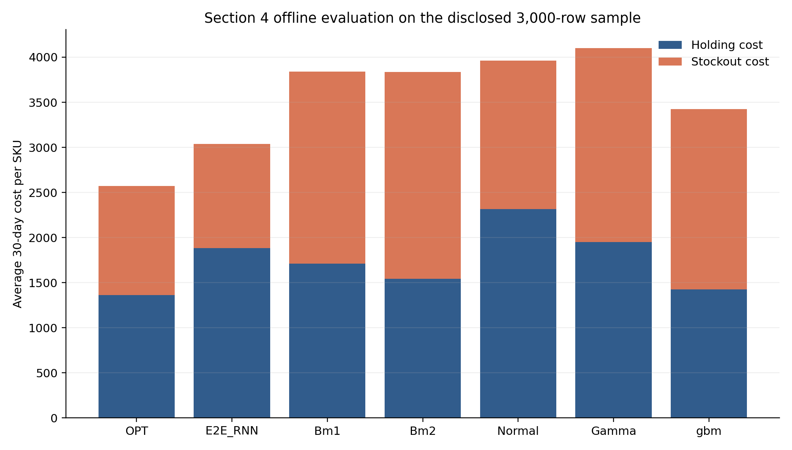
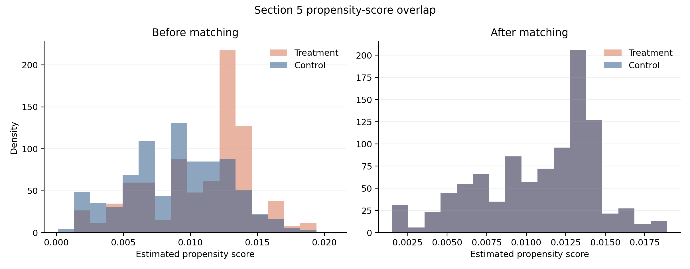
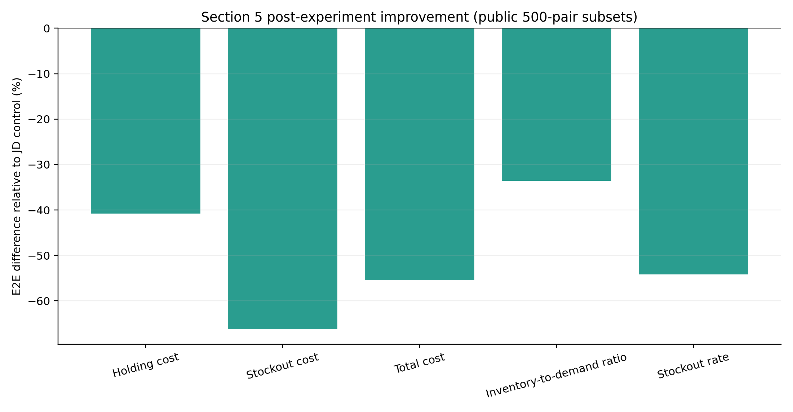
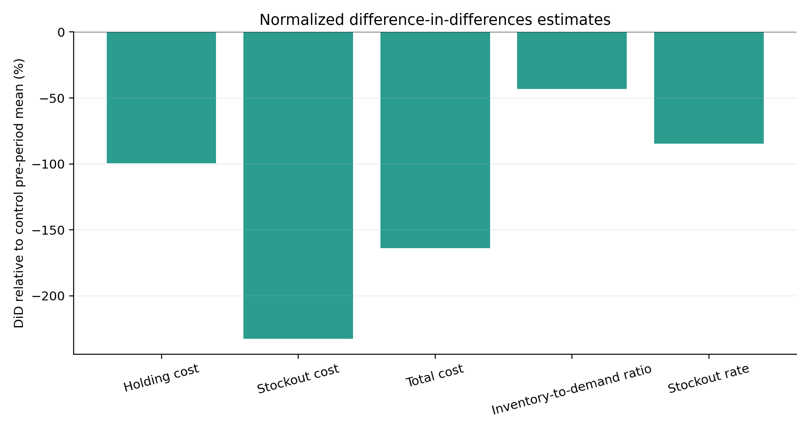

# 基于深度学习的端到端库存管理模型复现

## 摘要

本报告复现 Qi 等（2023）提出的端到端库存管理模型的主要实验结果。离线实验使用3,000条公开测试记录，对事后最优策略、端到端循环神经网络、两类预测优化基准、正态分布策略、Gamma分布策略和LightGBM策略进行统一库存成本评估。实地实验使用500个E2E处理组与500个JD控制组SKU–配送中心样本，依次完成倾向得分估计、协变量匹配、均值检验、线性回归和双重差分分析。结果显示，E2E_RNN的离线总成本为3036.76，较LightGBM降低11.33%；实地实验公开数据中，E2E组总成本较JD组降低55.46%，总成本DiD估计值为-1603.73。各项结果均支持端到端决策在库存持有与缺货损失之间取得更有效的平衡。

**关键词：** 库存管理；端到端学习；深度学习；预测优化；倾向得分匹配；双重差分

## 1. 研究背景与复现目标

传统库存决策通常采用“需求预测—补货优化”的两阶段框架。预测模型首先估计未来需求与供应商提前期，随后优化模型依据预测结果计算订货量。预测误差会进入后续优化环节，并影响最终库存成本。Qi等（2023）将补货决策直接设为神经网络输出，以事后最优订货量作为监督标签，使训练目标与库存成本保持一致。

本次复现聚焦论文第4节的离线策略比较以及第5节的实地实验统计，目标包括：重建库存递推与成本函数；复算七类策略的持有成本、缺货成本和总成本；检查处理组与控制组的协变量平衡；复算t检验、式(11)回归和双重差分结果；形成由代码、表格、图形和解释共同组成的实验记录。

## 2. 数据与实验设计

离线数据含3,000条订货周期记录、2,607个SKU标识。主要字段包括历史需求、初始库存、复查周期、供应商提前期统计量以及各模型给出的目标库存。实地实验数据记录SKU–配送中心层面的每日库存、每日需求、平均需求、平均库存和提前期。候选控制池包含55,333个SKU–配送中心样本。

公开实地实验Notebook将单位持有成本设为 $h=1$，单位缺货成本设为 $b=9$。论文正文的完整实地实验采用 $h=12$ 与 $b=88$。本次计算遵循公开代码参数，从而保持数据、代码和输出口径一致。

## 3. 模型与统计方法

库存状态按照 $I_{t+1}=I_t+A_t-d_t$ 递推，单期成本定义为

$$C_t=h[I_t]^+ + b[-I_t]^+,qquad [x]^+=max(x,0).$$

倾向得分模型为

$$P(T_i=1mid X_i)=operatorname{logit}^{-1}(eta_0+eta_1Demand_i+eta_2VLT_i).$$

论文式(11)的统计模型为

$$Y_i=	heta_0+	heta_1E2E_i+	heta_2Demand_i+	heta_3VLT_i+arepsilon_i.$$

双重差分估计量为

$$DiD=(ar Y_{E2E,post}-ar Y_{E2E,pre})-(ar Y_{JD,post}-ar Y_{JD,pre}).$$

## 4. 实验结果

### 4.1 离线策略比较

| 方法 | 持有成本 | 缺货成本 | 总成本 | 相对OPT差距（%） |
|---|---|---|---|---|
| OPT | 1363.22 | 1209.75 | 2572.96 | 0.00 |
| E2E_RNN | 1883.59 | 1153.17 | 3036.76 | 18.03 |
| Bm1 | 1709.36 | 2132.94 | 3842.31 | 49.33 |
| Bm2 | 1541.63 | 2296.20 | 3837.83 | 49.16 |
| Normal | 2317.10 | 1644.59 | 3961.69 | 53.97 |
| Gamma | 1947.84 | 2152.11 | 4099.95 | 59.35 |
| gbm | 1424.93 | 1999.94 | 3424.87 | 33.11 |

E2E_RNN在全部可实施策略中取得最低总成本。其相对OPT下界的成本差距为18.03%，显著小于BM1、BM2、Normal、Gamma和LightGBM。

### 4.2 倾向得分匹配

| 协变量 | 处理组均值 | 候选控制组均值 | 匹配控制组均值 | 匹配前SMD | 匹配后SMD |
|---|---|---|---|---|---|
| ave_demand | 2.2180 | 2.1488 | 2.2185 | 0.0108 | -0.0004 |
| vlt_num | 8.4840 | 11.1201 | 8.4840 | -0.4186 | 0.0000 |

平均需求的标准化均值差由0.0108降至-0.0004，提前期的标准化均值差由-0.4186降至0，匹配后控制组在两项协变量上与处理组高度接近。

### 4.3 实地实验均值检验

| 指标 | E2E组 | JD组 | 均值差 | 相对变化（%） | t统计量 | p值 |
|---|---|---|---|---|---|---|
| Holding cost | 497.990 | 841.428 | -343.438 | -40.816 | -7.575 | <0.001 |
| Stockout cost | 386.100 | 1143.720 | -757.620 | -66.242 | -7.766 | <0.001 |
| Total cost | 884.090 | 1985.148 | -1101.058 | -55.465 | -11.915 | <0.001 |
| Inventory-to-demand ratio | 12.269 | 18.471 | -6.202 | -33.579 | -5.478 | <0.001 |
| Stockout rate | 0.108 | 0.237 | -0.128 | -54.225 | -8.427 | <0.001 |

### 4.4 线性回归

| 指标 | 模型设定 | E2E系数 | 标准误 | t统计量 | p值 | 95%CI下限 | 95%CI上限 |
|---|---|---|---|---|---|---|---|
| Holding cost | 公开Notebook口径（无截距） | -220.5290 | 43.3545 | -5.0866 | <0.001 | -305.6056 | -135.4524 |
| Holding cost | 论文式(11)口径（含截距） | -343.3786 | 44.4829 | -7.7193 | <0.001 | -430.6695 | -256.0877 |
| Stockout cost | 公开Notebook口径（无截距） | -735.2393 | 88.7252 | -8.2867 | <0.001 | -909.3489 | -561.1298 |
| Stockout cost | 论文式(11)口径（含截距） | -757.4531 | 94.1074 | -8.0488 | <0.001 | -942.1247 | -572.7816 |
| Total cost | 公开Notebook口径（无截距） | -955.7684 | 81.9248 | -11.6664 | <0.001 | -1116.5332 | -795.0035 |
| Total cost | 论文式(11)口径（含截距） | -1100.8317 | 85.8112 | -12.8285 | <0.001 | -1269.2232 | -932.4402 |
| Inventory-to-demand ratio | 公开Notebook口径（无截距） | 0.3458 | 1.1812 | 0.2928 | 0.7698 | -1.9721 | 2.6637 |
| Inventory-to-demand ratio | 论文式(11)口径（含截距） | -6.2045 | 1.0868 | -5.7089 | <0.001 | -8.3372 | -4.0718 |
| Stockout rate | 公开Notebook口径（无截距） | -0.1019 | 0.0142 | -7.1563 | <0.001 | -0.1298 | -0.0740 |
| Stockout rate | 论文式(11)口径（含截距） | -0.1282 | 0.0149 | -8.6087 | <0.001 | -0.1575 | -0.0990 |

### 4.5 双重差分

| 指标 | E2E实验前 | E2E实验后 | E2E变化 | JD实验前 | JD实验后 | JD变化 | DiD估计值 | t统计量 | p值 |
|---|---|---|---|---|---|---|---|---|---|
| Holding cost | 666.394 | 497.990 | -168.404 | 506.460 | 841.428 | 334.968 | -503.372 | -8.477 | <0.001 |
| Stockout cost | 815.868 | 386.100 | -429.768 | 473.130 | 1143.720 | 670.590 | -1100.358 | -9.392 | <0.001 |
| Total cost | 1482.262 | 884.090 | -598.172 | 979.590 | 1985.148 | 1005.558 | -1603.730 | -14.150 | <0.001 |
| Inventory-to-demand ratio | 15.488 | 12.269 | -3.219 | 15.153 | 18.471 | 3.318 | -6.538 | -3.799 | <0.001 |
| Stockout rate | 0.236 | 0.108 | -0.128 | 0.198 | 0.237 | 0.039 | -0.167 | -7.693 | <0.001 |

## 5. 讨论

公开数据的结果方向与论文正文保持一致。数值差异主要来自样本规模和成本参数：论文表2至表4使用6,097对匹配样本，公开数据包含500对处理样本和500对控制样本；公开Notebook采用的成本权重也与论文实地实验设置有所差异。两套结果均显示E2E策略降低了持有成本、缺货成本、总成本、库存需求比和缺货率。

公开Notebook的OLS代码省略了截距项，论文式(11)包含截距项。报告同时给出两种设定。含截距模型中，E2E变量在五项指标上的系数均为负且达到统计显著；无截距模型中的库存需求比系数为0.3458，p值为0.7698。该差异说明模型设定会直接影响系数解释。

## 6. 结论

离线实验与实地实验共同表明，端到端模型能够直接学习库存决策目标，并降低预测误差在决策链条中的累积影响。公开数据复算得到的策略排序、成本变化方向和实地实验统计结论均与论文核心发现一致。E2E_RNN在离线比较中优于所有PTO基准；实地实验中，E2E组五项库存绩效指标均得到改善，回归与双重差分进一步支持该结果。

## 参考文献

Qi, M., Shi, Y., Qi, Y., Ma, C., Yuan, R., Wu, D., & Shen, Z.-J. M. (2023). A practical end-to-end inventory management model with deep learning. *Management Science, 69*(2), 759–773. https://doi.org/10.1287/mnsc.2022.4564
